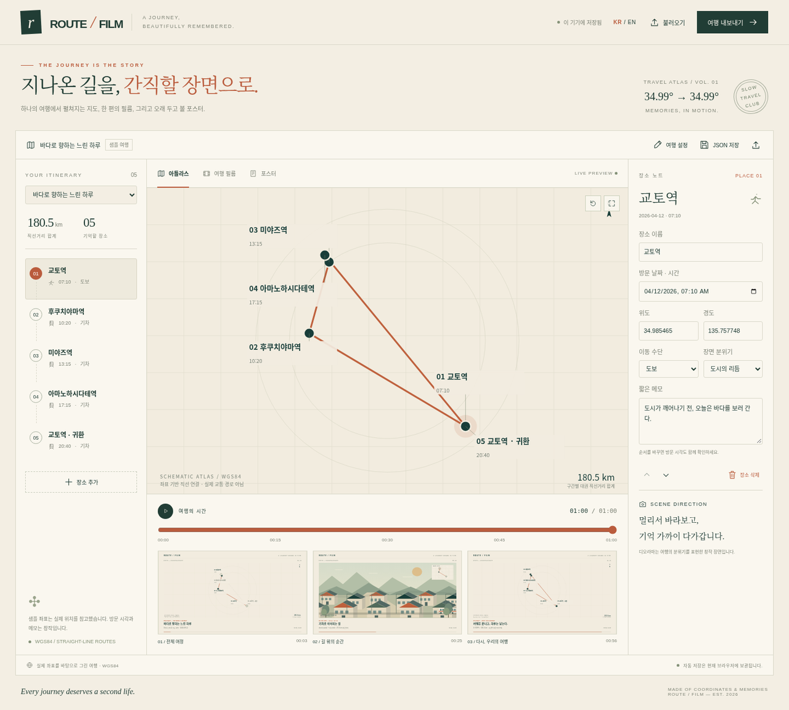

# ROUTE / FILM

**One journey. An atlas, a film, a print.**

루트 필름은 여행의 장소·시간·메모를 인터랙티브 아틀라스, 60초 영화, A3 포스터로 만드는 로컬 웹 앱입니다. 사진과 지도 서비스 키 없이, 코드로 그린 장면과 직접 합성한 사운드를 사용합니다.



## 실행

Node.js 22+, FFmpeg(`libx264`, AAC), Chromium, 한글을 지원하는 시스템 글꼴이 필요합니다. 검증 환경은 Node 24.19.0, FFmpeg 7.1.5, Chromium 154, Noto CJK입니다.

```bash
npm ci
npm start
```

서버는 기본적으로 `127.0.0.1:3000`에 바인딩합니다. 개인 개발 환경에서 브라우저로 접속하세요. Codex 환경에서는 지원되는 앱 접속 방식을 사용하고, 루프백 주소를 공개 공유 링크로 취급하지 마세요.

```bash
# 선택적 설정을 적용할 때
node --env-file=.env server.mjs
```

`.env.example`을 `.env`로 복사해 포트·Chromium 경로·FFmpeg 스레드 수를 조정할 수 있습니다. 기본 동작에는 API 키나 계정이 필요하지 않습니다. 이 앱은 로컬 개인 도구이며 인증을 갖춘 공개 다중 사용자 서비스가 아닙니다.

## 사용 흐름

1. 교토 또는 서울 샘플로 시작합니다. 샘플의 시간과 메모는 창작입니다.
2. 여행 제목과 장소의 이름·위도·경도·날짜·시간·교통수단·장면·메모를 수정합니다. 방문 순서를 바꾸고 장소를 추가하거나 제거할 수 있습니다.
3. 아틀라스에서 장소를 선택하고 타임라인을 움직입니다. 영화 미리보기에서 장면과 자막을 확인합니다.
4. 영상 또는 포스터를 생성합니다. 영상은 진행률을 확인하거나 취소할 수 있고, 실패한 작업은 같은 입력으로 다시 시도할 수 있습니다.
5. MP4·PDF·SVG·PNG, 인터랙티브 아틀라스 HTML과 여행 JSON을 내려받습니다. 메모나 경로를 수정한 후 다시 생성하면 새 입력을 반영한 결과가 만들어집니다.

브라우저의 여행 편집 상태는 localStorage에 저장됩니다. 장치 간 이동이나 장기 보관에는 JSON 내보내기를 사용하세요. 렌더링 작업은 제출 당시의 여행 사본을 사용하므로 생성 중의 편집은 이미 진행 중인 영상에 섞이지 않습니다.

## 출력과 재생성

기본 영화는 **60초 / 1920×1080 / 30fps / H.264 + AAC**입니다. 세로형은 **1080×1920**입니다. 사운드는 시드에 따라 재현되는 화음·벨·필터 노이즈를 코드로 합성합니다. 외부 음원이나 모델 API를 호출하지 않습니다.

포스터는 **A3 297×420mm SVG/PDF**, **3508×4961 PNG(300dpi)**입니다. 원본 여행 JSON도 함께 저장됩니다. 같은 여행 JSON·시드·설정으로 다시 렌더링하면 같은 장면 구성과 타이밍을 얻습니다. 글꼴·브라우저·FFmpeg 버전이 다른 머신 사이에서 바이너리 파일까지 동일하다는 보장은 아닙니다.

인터랙티브 `atlas.html`은 여행과 렌더러를 한 파일에 담습니다. 다운로드 후 브라우저에서 열면 인터넷 연결 없이 지도·장소 선택·시간 탐색·영화 장면 미리보기를 사용할 수 있습니다. 여행을 수정하거나 새 MP4를 만들 때는 전체 앱을 실행하세요. 기본 두 여행의 파일만 만들려면 `npm run export:atlas`, 자신의 JSON을 사용하려면 `node scripts/export-atlas.mjs trip.json atlas.html`을 실행합니다.

`data/renders/<작업 ID>/`에 `trip.json`, `job.json`, `film.mp4`, `poster.svg`, `poster.pdf`, `poster.png`가 저장됩니다. 합성 중간 음원도 작업 디렉터리에 생성됩니다. `data/`, `artifacts/`, `node_modules/`, `dist/`는 Git 추적 대상이 아닙니다. 생성 결과를 보관할 때는 이 폴더를 별도로 백업하세요. 서버가 중단되면 진행 중이던 작업은 다음 시작 시 실패 상태로 복구되며 사용자가 다시 시도할 수 있습니다.

## 검증과 빌드

```bash
npm test
npm run build

# npm start로 앱이 실행 중인 상태에서, 별도 터미널에서 실행
npm run test:ui
npm run validate
npm run validate:portrait
node scripts/ui-check.mjs --media
```

`test:ui`는 편집·저장·복원·JSON 입출력·미리보기·영문 전환·모바일 레이아웃을 Chromium에서 검사합니다. `validate`는 **교토와 서울의 60초 가로 영상 두 편**을 실제로 생성해 검사하고, `validate:portrait`는 **60초 세로 영상 한 편**을 생성합니다. `--media` 검사는 완료된 60초 결과물의 실제 브라우저 재생과 장면 탐색을 확인합니다. 검증 도구에는 FFmpeg/ffprobe 외에 Poppler의 `pdfinfo`, `pdftotext`가 필요합니다. 서버 주소가 다르면 `APP_URL`을 지정하세요.

빠른 기술 검증에는 `node scripts/validate.mjs --prototype`을 사용할 수 있습니다. 이 명령은 같은 경로로 12초 영상을 출력하며 전체 60초 검증을 대체하지 않습니다. 결과는 `artifacts/kyoto/`, `artifacts/seoul/`, `artifacts/portrait/`와 JSON 검사 보고서에 보관됩니다. 각 폴더에는 영상, 포스터, 여행 JSON, 장면별 주요 프레임과 contact sheet가 들어갑니다.

`build`는 실제 앱 모듈의 문법·진입점을 확인하고 `dist/`에 서버와 정적 파일을 복사하며 파일 해시를 기록합니다. 프런트엔드는 브라우저 ES 모듈로 실행되어 번들러가 필요하지 않습니다. 서버와 FFmpeg가 필요한 앱이므로 `dist/`의 정적 파일만 호스팅해서는 영상 출력 API가 동작하지 않습니다.

```bash
cd dist
npm ci --omit=dev
npm start
```

검사 범위와 현재 결과는 [검증 기록](docs/PROGRESS.md)을 확인하세요. 단위 테스트 통과와 실제 MP4·PDF·브라우저 검증을 구분해 기록합니다.

## 데이터 해석

지도는 실제 WGS84 대표 좌표를 투영한 여행 모식도입니다. 연결선은 **방문 순서의 직선 연결**이며 도로·철도·항로가 아닙니다. 거리는 Haversine으로 계산한 지점 간 대권거리의 합으로, 실제 이동거리와 다릅니다. 같은 장소를 다시 방문하면 다른 방문 ID와 같은 좌표를 가질 수 있습니다.

도시·산·물가·밤의 디오라마는 여행의 분위기를 표현한 창작 장면입니다. 실제 장소의 건물·해안선·지형을 정밀 복원한 기록이 아닙니다. 장소 좌표는 편집할 수 있으며 길찾기·측량·교통 운영 정보로 사용하지 마세요. 날짜·시각은 입력한 현지 시각의 순서를 나타내며 시간대 자동 변환 기능은 포함하지 않습니다.

## 구성

- `shared/core.mjs`: 검증·정규화·거리·타임라인·SVG 지도/장면/포스터.
- `shared/samples.mjs`: 서로 다른 두 샘플 여행.
- `public/`: 편집기·미리보기·저장/복원·출력 UI.
- `server.mjs`: 작업 큐·CPU 영상 인코딩·합성 음악·포스터·결과 다운로드.
- `test/`, `scripts/`: 단위/API/브라우저 검증과 빌드.
- `docs/`: [Goal](docs/GOAL.md), [시나리오·콘티](docs/STORYBOARD.md), [출처·라이선스](docs/SOURCES.md), [진행·검증](docs/PROGRESS.md).

## 비용과 라이선스

기본 실행에는 유료 API·지도 구독·이미지 생성 비용이 없습니다. 로컬 또는 클라우드 머신의 CPU·메모리·저장 공간을 사용하며, 공개 배포 시에는 해당 호스팅 비용이 발생할 수 있습니다. 개발에 사용한 Codex 사용량은 제품 실행 비용과 별개입니다.

Route Film의 원본 소스는 MIT 라이선스입니다. 참고 저장소의 코드는 복사하지 않았습니다. 참고 프로젝트·장소 사실·런타임 의존성의 출처와 라이선스는 [SOURCES.md](docs/SOURCES.md)에 기록합니다. 스톡 이미지·음원·유료 에셋을 포함하지 않습니다.

소스 저장소는 사용자가 공개 업로드를 승인한 [landfill/route-film](https://github.com/landfill/route-film)입니다. 여행 데이터와 대용량 렌더링 결과는 Git에 포함하지 않습니다.

## English quick start

Route Film turns one editable itinerary into a live atlas, a deterministic short film and an A3 print. Install Node.js 22+, FFmpeg with H.264/AAC support, Chromium and CJK fonts, then run `npm ci && npm start`. Set `CHROMIUM_PATH` if Chromium is installed elsewhere. No API keys are required.

Edit a sample or import your trip JSON, preview the sequence, then export MP4, PDF, SVG and PNG. Save your JSON for portable backups. The map connects representative WGS84 coordinates with straight lines; distances are geodesic segment totals, not routing directions. Times and notes in the samples are fictional. Procedural dioramas express a journey's mood and do not reconstruct real terrain. Rendering happens on the local Node server with CPU frames and FFmpeg; no hardware video encoder is required.
